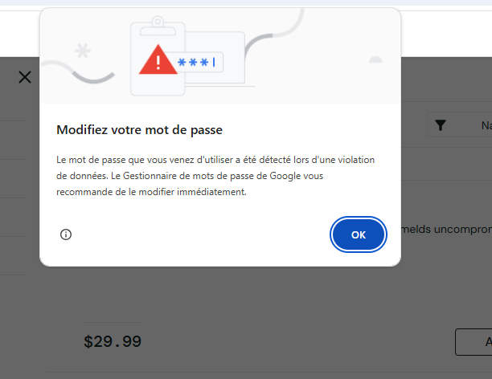
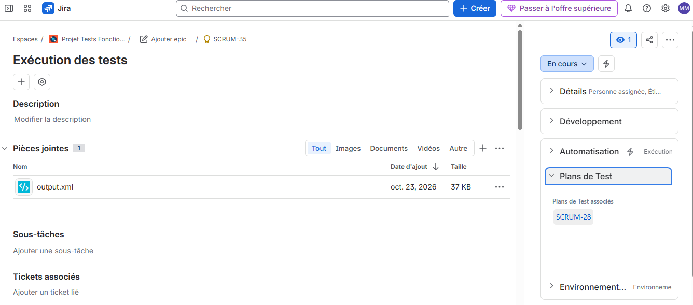
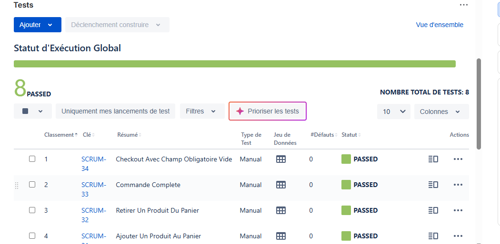
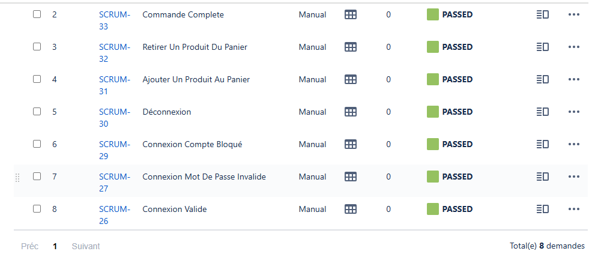

# Projet QA: tests automatisés avec Robot Framework et Xray

Ce projet automatise des tests fonctionnels sur [SauceDemo](https://www.saucedemo.com), un site e-commerce de démonstration. Il couvre trois parcours : la connexion, le panier et la commande, soit 8 cas de test.

Je l'ai réalisé pour me former à l'automatisation des tests : écrire des cas de test clairs, les automatiser avec Robot Framework et SeleniumLibrary, organiser le code de façon réutilisable, et analyser les échecs à partir des rapports. Issue d'une formation en biologie moléculaire et en data science (Master CCI, Lyon 1), j'y applique la même rigueur de protocole que celle du laboratoire : un cas de test, un résultat attendu, une vérification reproductible.

## Arborescence du projet
```
resources/    → mots-clés réutilisables
tests/        → fichiers de tests (login, panier, checkout)
results/      → rapports générés (non versionnés)
Images/
```

## Outils utilisés
- Robot Framework, SeleniumLibrary
- Jira / Xray
- Python

## Cas de test
| ID | Cas de test | Fichier | Résultat attendu | Statut |
|---|---|---|---|---|

| 1 | Connexion valide | `login.robot` | La page des produits s'affiche | ✅ Passé |

| 2 | Connexion avec mot de passe invalide | `login.robot` | Message d'erreur affiché | ✅ Passé |

| 3 | Connexion avec un compte bloqué | `login.robot` | Message « locked out » affiché | ✅ Passé |

| 4 | Déconnexion | `login.robot` | Retour à la page de connexion | ✅ Passé |

| 5 | Ajouter un produit au panier | `panier.robot` | Le compteur du panier affiche 1 | ✅ Passé |

| 6 | Retirer un produit du panier | `panier.robot` | Le compteur disparaît | ✅ Passé |

| 7 | Commande complète | `checkout.robot` | Message « Thank you for your order » | ✅ Passé |

| 8 | Checkout avec champ obligatoire vide | `checkout.robot` | Message « First Name is required » | ✅ Passé |

## Difficulté rencontrée: 
1. un test instable:

Lors de mes premières exécutions, le test **Connexion valide** donnait des résultats différents d'une exécution à l'autre, sans aucune modification du code. Il passait parfois et échouait parfois.

**Cause:** Robot Framework vérifiait la présence de la liste des produits avant que la page ne soit entièrement chargée.

**Correction:** j'ai remplacé la vérification immédiate par une attente explicite:
```robotframework
Wait Until Page Contains Element    id=inventory_container    timeout=10s
```

Le test attend désormais jusqu'à 10 secondes que la page apparaisse avant de continuer.

Le test **Connexion avec mot de passe invalide** était plus stable: 
le message d'erreur s'affiche sur la même page, sans changement de page, donc il n'y a pas de temps de chargement à attendre.

2. le test « Retirer un produit du panier » :

J'ai rencontré le même type de problème sur ce test. Après un clic sur « Add to cart », le bouton est remplacé par « Remove ». Dans ma première version, Robot Framework cliquait sur « Remove » environ 0,3 seconde après l'ajout, avant que ce changement ne soit effectif. Le bouton était introuvable et le test échouait avec le message `Button with locator 'id=remove-sauce-labs-backpack' not found`.

**Correction :** j'ai ajouté deux attentes explicites, qui laissent jusqu'à 10 secondes à la page pour se mettre à jour :

```robotframework
Wait Until Element Is Visible    id=remove-sauce-labs-backpack    timeout=10s
Wait Until Page Does Not Contain Element    class=shopping_cart_badge    timeout=10s
```

La première attend l'apparition du bouton « Remove » avant de cliquer, la seconde attend la disparition de la pastille du panier avant de vérifier le résultat. Le test passe désormais.

**Ce que j'en retiens :** un test automatisé s'exécute plus vite qu'un utilisateur. Il faut donc attendre explicitement chaque changement de la page dont l'étape suivante dépend.

3. une fenêtre du navigateur qui perturbe les tests :

Après avoir stabilisé les attentes, mes tests échouaient encore de façon intermittente (login, panier, checkout), avec des messages comme `Button with locator 'id=checkout' not found` ou `NoSuchWindowException: no such window`. Le code n'avait pas changé entre deux exécutions.

**Diagnostic :** une capture d'écran prise pendant un lancement a montré la cause : après la connexion, Chrome affichait la fenêtre « Modifiez votre mot de passe », car le mot de passe de démonstration de SauceDemo figure dans une base de mots de passe compromis. Cette alerte n'apparaissait pas à chaque exécution, ce qui expliquait le caractère intermittent des échecs. Elle masquait la page et bloquait les clics de Robot.


**Correction :** j'ai modifié le mot-clé `Ouvrir SauceDemo` pour lancer Chrome en navigation privée, avec le gestionnaire de mots de passe et la détection de fuites désactivés :

```robotframework
Ouvrir SauceDemo
    Open Browser    ${URL}    ${BROWSER}
    ...    options=add_argument("--incognito");add_experimental_option("prefs", {"credentials_enable_service": False, "profile.password_manager_enabled": False, "profile.password_manager_leak_detection": False})
    Wait Until Element Is Visible    id=login-button    timeout=10s
```

Comme tous les tests passent par ce mot-clé, la correction s'applique d'un seul coup à toute la suite.

**Résultat :** les 8 tests ont été exécutés 3 fois de suite sans aucun échec.

**Ce que j'en retiens :** un test peut échouer pour une raison extérieure à l'application et au code de test, ici une fenêtre du navigateur. Une capture d'écran au moment de l'échec permet d'identifier ce genre de cause bien plus vite que la lecture des logs seule. Avoir centralisé l'ouverture du site dans un mot-clé réutilisable a permis de corriger le problème en un seul endroit.


## Captures d'écran


Capture 2 : le Test Execution SCRUM-35, lié au Test Plan SCRUM-28, avec output.xml en pièce jointe.

Captures 3 et 4 : les 8 tests, tous PASSED, et la barre verte « Statut d’Exécution Global ».



Les 8 cas de test sont formalisés dans Jira avec Xray, regroupés dans un Test Plan (SCRUM-28) et exécutés dans un Test Execution (SCRUM-35). Après exécution de la suite Robot Framework, j'ai reporté les résultats dans Xray et joint le rapport `output.xml` au ticket.

L'import automatique du fichier de résultats via l'API Xray n'est pas encore en place : c'est une piste d'amélioration.

## Bilan

Les 8 tests s'exécutent et passent. Ce projet m'a surtout appris trois choses :

- **Un test qui passe n'est pas forcément un test fiable.** Deux de mes tests ont échoué de façon intermittente parce que Robot Framework agissait plus vite que la page ne se chargeait. Je les ai stabilisés avec des attentes explicites (`Wait Until...`) à chaque changement de la page.
- **Le code de test doit être maintenable.** En regroupant les actions répétées dans `resources/keywords.resource`, mes tests sont plus courts et un changement du site ne demande de corriger qu'un seul endroit.
- **Il faut choisir ses cas de test.** J'ai retenu les cas qui couvrent des comportements différents (cas nominal, cas d'erreur) plutôt que de multiplier des tests redondants.


